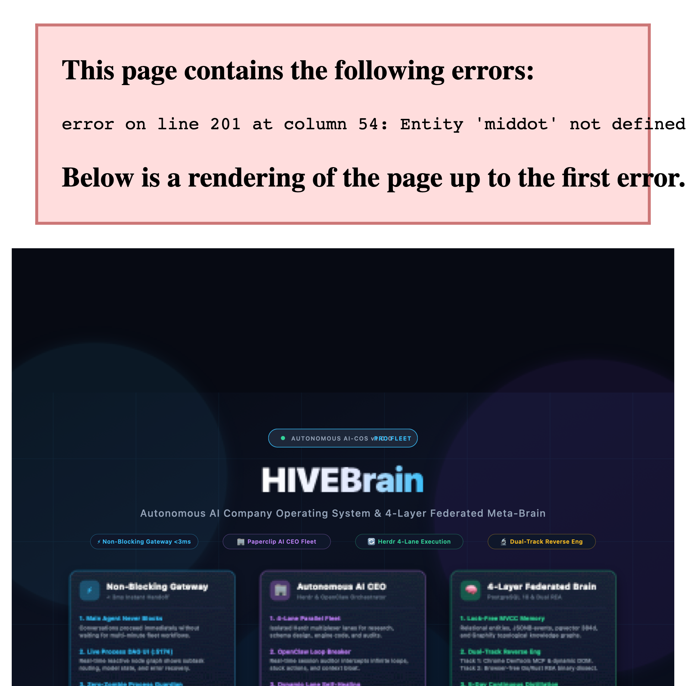
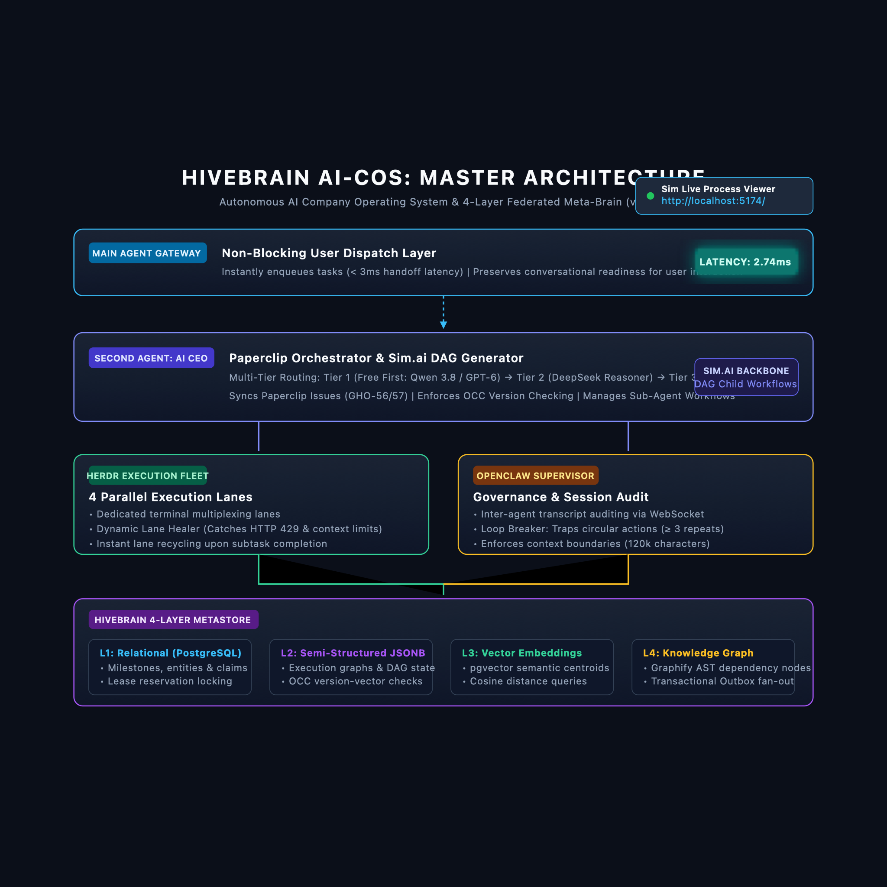
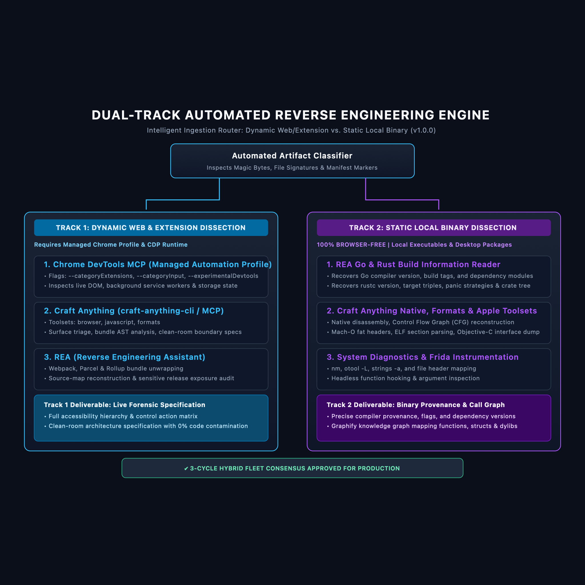

<p align="center">
  
</p>

<p align="center">
  <a href="#quickstart"><strong>Quickstart</strong></a> &middot;
  <a href="#core-architecture"><strong>Architecture</strong></a> &middot;
  <a href="#the-four-layer-meta-brain"><strong>4-Layer Meta-Brain</strong></a> &middot;
  <a href="#ai-ceo--herdr-fleet"><strong>AI CEO &amp; Herdr Fleet</strong></a> &middot;
  <a href="#dual-track-reverse-engineering"><strong>Reverse Engineering</strong></a> &middot;
  <a href="#live-process-viewer"><strong>Live Viewer UI</strong></a> &middot;
  <a href="#rfcs--specifications"><strong>RFCs</strong></a>
</p>

<p align="center">
  <a href="https://github.com/GhostProtocolOps/hivebrain"></a>
  
  
  
  
  
  <a href="https://github.com/GhostProtocolOps/hivebrain/stargazers"></a>
</p>

<br/>

# HIVEBrain: Autonomous AI Company Operating System (AI-COS)

**HIVEBrain** is an enterprise-grade autonomous operating system that transforms multi-model AI agents into a coordinated software engineering company. 

Built on a non-blocking gateway architecture with sub-3ms handoffs, HIVEBrain delegates execution to an autonomous **Second Agent (Paperclip AI CEO)** overseeing an isolated 4-lane parallel fleet (Herdr), continuous session supervision (OpenClaw), dynamic model healing, and a unified 4-layer federated storage ledger.

---

## ⚡ Key Capabilities

- **Zero-Blocking User Gateway (<3ms)**: The Main Agent never pauses for long-running workflows. Prompts are validated, fingerprinted, and handed off asynchronously to the AI CEO in `< 3ms`, leaving the chat interface instantly responsive.
- **Paperclip AI CEO & Herdr Fleet**: Automatically decomposes projects into DAG micro-tasks across 4 parallel execution lanes:
  - `lane_research`: Free Qwen 3.8 Max / Web research
  - `lane_schema`: GPT-6 Luna / Structured contract design
  - `lane_code`: Local Codex Pro CLI / DeepSeek Reasoner implementation
  - `lane_audit`: Adversarial consensus review & test validation
- **OpenClaw Session Watchdog**: Real-time auditor traps infinite action loops, circular tool dependencies, and context memory leaks before they consume tokens.
- **Dynamic Lane Self-Healing**: Automatically intercepts HTTP 429 rate limits, promotes pre-planned backup models (e.g. DeepSeek R1), and resumes execution directly from the last HIVEBrain transaction checkpoint.
- **4-Layer Federated Meta-Brain**: Complete transactional state persistence across Relational SQL entities, append-only JSONB telemetry, pgvector 384-dim semantic embeddings, and Graphify topological knowledge graphs.
- **Dual-Track Reverse Engineering Engine**: Automated target classification for web/extension environments (Track 1: Chrome DevTools MCP & clean-room DOM analysis) versus native binaries (Track 2: Browser-free Go/Rust binary reconstruction via REA).
- **Sim Live Process Viewer (`:5174`)**: Real-time reactive web DAG streaming live execution states, node telemetry, model routing, and self-healing recovery.
- **Process Guardian**: Lifecycle manager automatically monitors parent PIDs, boots required background daemons, and cleanly reaps child processes on IDE close or shutdown.

---

## 🏛️ Core Architecture

<p align="center">
  
</p>

```
+---------------------------------------------------------------------------------------------------+
|                                  NON-BLOCKING USER GATEWAY (<3ms)                                 |
+---------------------------------------------------------------------------------------------------+
                                                  |  (Async Handoff)
                                                  v
+---------------------------------------------------------------------------------------------------+
|                             SECOND AGENT: PAPERCLIP AI CEO ORCHESTRATOR                           |
|       - 3-Stage Blueprint Review Gate (Adversarial Qwen Consensus)                                |
|       - Dynamic Task Graph Decomposer & Cost Optimization Router                                  |
+---------------------------------------------------------------------------------------------------+
       |                                |                               |                    |
       v                                v                                v                    v
+--------------+                +---------------+               +---------------+    +---------------+
| LANE RESEARCH|                |  LANE SCHEMA  |               |   LANE CODE   |    |  LANE AUDIT   |
| (Qwen 3.8)   |                |  (GPT-6 Luna) |               |  (Codex CLI)  |    | (DeepSeek R1) |
+--------------+                +---------------+               +---------------+    +---------------+
       |                                |                               |                    |
       +--------------------------------+-------------------------------+--------------------+
                                                  |
                                                  v
+---------------------------------------------------------------------------------------------------+
|                                 OPENCLAW SESSION SUPERVISOR & HEALER                              |
|       - Infinite Loop Breaker (3-Action Threshold)      - Context Window Bloat Trap               |
|       - Automatic 429 Model Swapper (Backup Promotion)   - Zero-Zombie Process Guardian            |
+---------------------------------------------------------------------------------------------------+
                                                  |
                                                  v
+---------------------------------------------------------------------------------------------------+
|                               4-LAYER FEDERATED HIVEBRAIN LEDGER                                  |
|  [Layer 1: Relational SQL]   [Layer 2: JSONB Events]   [Layer 3: pgvector 384d]  [Layer 4: Graph] |
+---------------------------------------------------------------------------------------------------+
```

---

## 🔬 Dual-Track Reverse Engineering Engine

HIVEBrain's reverse engineering subsystem (`src/reverse_engineering.py`) automatically bifurcates targets into specialized clean-room analysis pipelines:

<p align="center">
  
</p>

### Track 1: Dynamic Web Application & Chrome Extension Dissection
- **Trigger**: Web URLs, Chrome Extensions (`manifest.json`), DOM-heavy SPAs.
- **Toolchain**: Chrome DevTools MCP (`--categoryExtensions`, `--categoryInput`), Craft Anything, REA bundle exposure auditor, and Graphify.
- **Phases**: Manifest audit, runtime CSP validation, live service worker tracing, DOM snapshot extraction, network telemetry interception.

### Track 2: Static Local Binary & Desktop Dissection (Browser-Free)
- **Trigger**: Mach-O, ELF, PE32+ executables, compiled Go or Rust binaries, static libraries.
- **Toolchain**: REA Core (`go_build_metadata`, `rust_build_metadata`), Craft Native (`craft-anything-cli`), local OS diagnostics (`nm`, `otool`, `file`).
- **Guarantee**: Runs 100% locally and browser-free with zero headless browser or CDP overhead.

---

## 🗄️ The Four-Layer Meta-Brain

```sql
-- Transactional State (schema.sql)
CREATE TABLE tasks (
    id TEXT PRIMARY KEY,
    name TEXT NOT NULL,
    status TEXT NOT NULL, -- pending, running, completed, failed
    lane_id TEXT,
    assigned_model TEXT,
    created_at TIMESTAMPTZ DEFAULT NOW()
);

-- Layer 2: Append-Only Telemetry Events
CREATE TABLE event_log (
    id BIGSERIAL PRIMARY KEY,
    run_id TEXT NOT NULL,
    event_type TEXT NOT NULL,
    payload JSONB NOT NULL,
    created_at TIMESTAMPTZ DEFAULT NOW()
);

-- Layer 3: pgvector 384-Dimensional Semantic Memory
CREATE TABLE semantic_memory (
    id TEXT PRIMARY KEY,
    embedding vector(384),
    content TEXT NOT NULL,
    metadata JSONB
);
```

1. **Layer 1: Relational Tables**: ACID transactions with total-order airline booking reservation locks.
2. **Layer 2: JSONB Telemetry**: Lock-free MVCC append-only event log capturing every subtask transition.
3. **Layer 3: pgvector (384-dim)**: Fast semantic cosine retrieval for persistent cross-agent recall.
4. **Layer 4: Graphify Graph**: Dynamic code dependency graphs and architectural blast-radius assessment.

---

## 🚀 Quickstart

### Prerequisites
- macOS / Linux
- Python 3.11+
- Node.js 18+ (for Live Process Viewer)
- PostgreSQL 18 with `pgvector`
- `serversctl` Background Supervisor

### 1. Verification & Service Health
Check the status of all HIVEBrain background infrastructure:
```bash
# Verify master supervisor
serversctl status

# Run full test suite (16 tests across Gateway, Fleet, and REA)
python3 -m unittest discover tests/
```

### 2. Launching Autonomous Projects (Non-Blocking)
Dispatch any project or research task to the background AI CEO:
```python
from src.gateway import AICompanyGateway

gateway = AICompanyGateway()

# Async dispatch - returns immediately in < 3ms
result = gateway.submit_request(
    prompt="Reverse engineer target binary and generate clean-room Go implementation",
    author="lead_architect"
)

print(f"Run ID: {result['run_id']}")
print(f"Viewer URL: {result['viewer_url']}")
# Returns: {'status': 'accepted_non_blocking', 'run_id': 'aic_run_...', 'latency_ms': 2.8}
```

### 3. Live Dashboard UI
Open your browser to inspect real-time fleet operations:
```
http://localhost:5174/
```

---

## 🤖 Multi-Model Collaboration Matrix

HIVEBrain employs an intelligent Tiered Cost & Resilience Routing Matrix:

| Tier | Model | Cost | Purpose |
| :--- | :--- | :--- | :--- |
| **Tier 1 (Free First)** | `free/qwen-3.8-max` | $0.00 | Broad research, documentation synthesis, audit consensus |
| **Tier 1 (Free First)** | `free/gpt-6-luna` | $0.00 | Schema validation, JSON formatting, type contracts |
| **Tier 1 (Free First)** | `free/gemini-4-hydrogen` | $0.00 | Rapid summarization and multimodal analysis |
| **Tier 2 (High Assurance)** | `deepseek-chat` | Paid | Primary failover on 429 rate limits |
| **Tier 2 (Reasoning)** | `deepseek-reasoner` (R1) | Paid | Mathematical verification, deep bug fixes, complex AST logic |
| **Local Full-Access** | `codex-cli` | ChatGPT Pro | Local workspace file mutations, diff audits, shell execution |

*Circuit Breaker Protection: Automatically isolates paid DeepSeek balances from accidental retry storms if upstream free endpoints encounter high load.*

---

## 📚 RFCs & Specifications

Complete technical specifications and formal architecture designs are preserved in the repository:

- [**RFC-014: HIVEBrain 4-Layer Federated Architecture**](RFC-014-HIVEBRAIN-META-BRAIN.md)
- [**RFC-015: Autonomous AI Company Operating System (AI-COS)**](RFC-015-AUTONOMOUS-AI-COMPANY-OS.md)
- [**RFC-016: Professional AI Tool Pipeline & Lifecycle Guardian**](RFC-016-AUTONOMOUS-AI-COMPANY-OS-TOOL-PIPELINE.md)
- [**RFC-017: Dual-Track Reverse Engineering & Hybrid Fleet**](docs/RFC-017-REVERSE-ENGINEERING-AND-HYBRID-FLEET.md)
- [**Master Architecture Diagram (.figcraft)**](design/AI_COS_Master_Architecture.figcraft)
- [**Reverse Engineering Workflows (.figcraft)**](design/Reverse_Engineering_Workflows.figcraft)

---

## 🛡️ License

Apache License 2.0. See [LICENSE](LICENSE) for details. Built by GhostProtocolOps.
