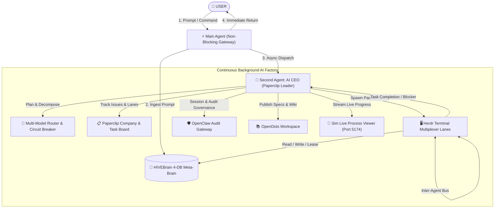
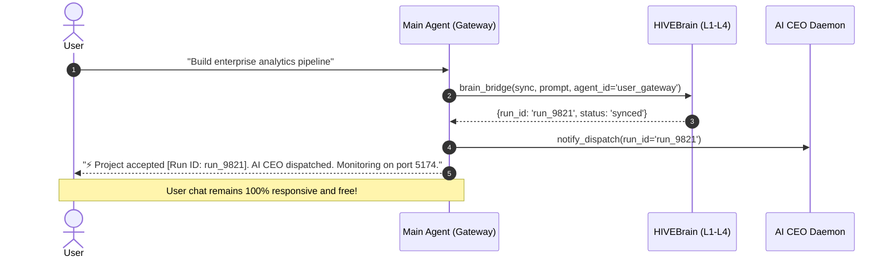
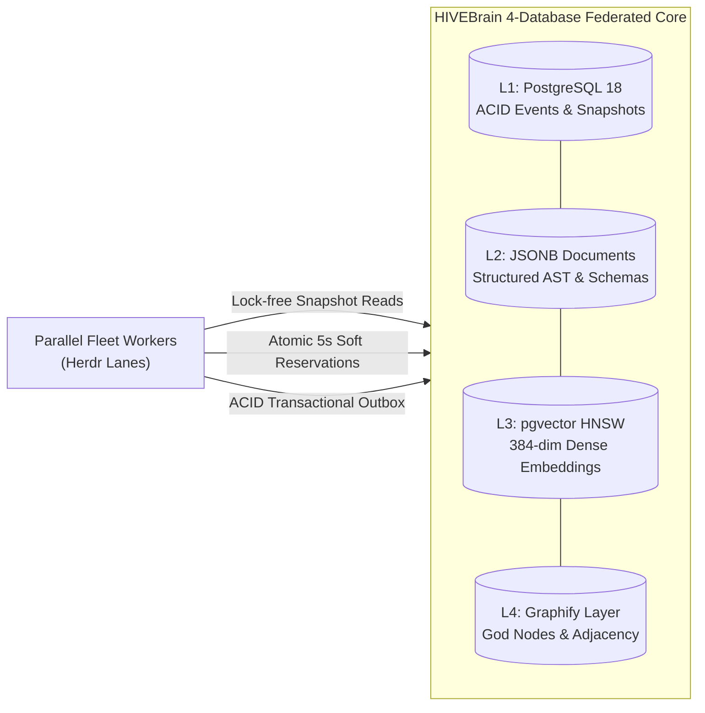
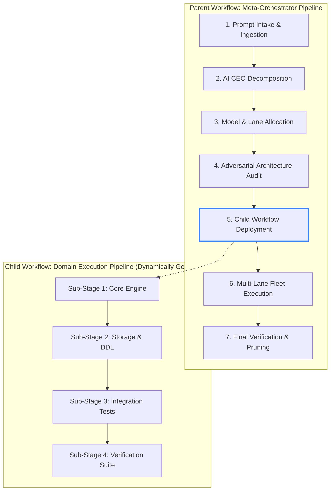
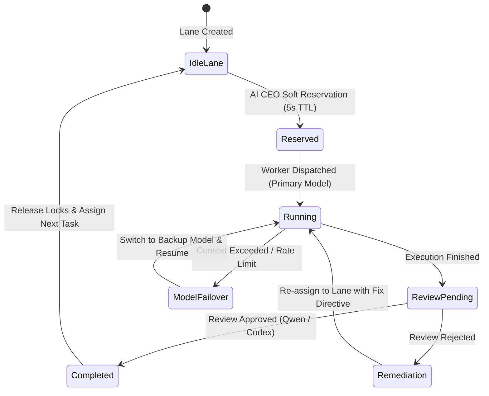

# RFC-015: Autonomous AI Company Operating System (AI-COS)
## Complete Architectural Blueprint for Non-Blocking Multi-Agent Fleet Orchestration

---

## 1. Executive Summary & Core Invariant

The **Autonomous AI Company Operating System (AI-COS)** decouples user interaction from heavy multi-agent execution. 

> [!IMPORTANT]
> **The Non-Blocking Invariant**: The **Main Agent** (User Gateway) is **strictly non-blocking**. Upon receiving any user prompt—whether a simple `"hello"`, a status inquiry, or an enterprise-scale software directive—the Main Agent records the intent into **HIVEBrain**, dispatches the goal asynchronously to the **AI CEO Orchestrator**, and immediately returns to the user. The user's chat interface is never locked waiting for multi-hour background processes.



---

## 2. System Architecture: The 7 Core Modules

AI-COS is organized into 7 modular, plug-and-play components:

```
┌─────────────────────────────────────────────────────────────────────────────┐
│                    AI-COS ENTERPRISE ARCHITECTURE                           │
├─────────────────────────────────────────────────────────────────────────────┤
│  1. Non-Blocking Gateway (Main Agent / User Front-End)                      │
│  2. AI CEO Orchestrator (Paperclip Company Leader & Background Daemon)      │
│  3. Execution Lanes & Inter-Agent Bus (Herdr + OpenClaw)                   │
│  4. Central Federated Meta-Memory (HIVEBrain 4-DB Layer)                   │
│  5. Cost-Optimized Multi-Model Router (APInex Free ➔ DeepSeek ➔ Codex)     │
│  6. Dynamic Visual Telemetry (Parent-Child Sim.ai Process Graph)            │
│  7. Adversarial Review Gate & Adaptive Lane Reassignment                   │
└─────────────────────────────────────────────────────────────────────────────┘
```

---

### Module 1: Non-Blocking Gateway (Main Agent)

- **Role**: High-availability conversational interface.
- **Behavior**:
  - Never sleeps or waits for background tasks.
  - Generates an immediate `execution_run_id` and registers the request in `HIVEBrain` via `brain_bridge(action="sync")`.
  - Queues the task into Paperclip project backlog.
  - Answers user questions (`"what is the progress?"`, `"show active lanes"`, etc.) by executing instantaneous **lock-free MVCC reads** from HIVEBrain and Paperclip API (< 20ms).



---

### Module 2: AI CEO Orchestrator (Paperclip Leader)

- **Role**: Autonomous company director and workflow compiler.
- **Workflow Compilation**:
  1. **Prompt Ingestion**: Pulls assigned run from HIVEBrain.
  2. **Micro-Task Decomposition**: Breaks down the project into hierarchical sub-tasks with dependency graphs.
  3. **Resource & Model Allocation**:
     - Computes task complexity score.
     - Assigns primary model, temperature, and effort level.
     - Designates a fallback model + effort if rate limits or context windows exhaust.
  4. **Child Workflow Blueprint Generation**: Compiles a domain-specific Sim.ai process graph representing the project.
  5. **Submission to Review Gate**: Passes the blueprint to specialized reviewer agents (e.g. Qwen 3.8 Max / Codex) before allocating execution lanes.

---

### Module 3: Execution Lanes & Inter-Agent Bus (Herdr + OpenClaw)

- **Herdr Parallel Lanes**:
  - Each active worker runs in a dedicated, isolated Herdr pane/workspace.
  - Workers communicate via the Herdr socket bus (`~/.config/herdr/herdr.sock`).
  - When Lane $K$ finishes a task, it fires a `lane_free` notification to the AI CEO, which immediately dispatches the next queued dependency.
- **OpenClaw Governance**:
  - Monitors inter-agent message volume and token consumption.
  - Intercepts circular debates or runaway reasoning loops.
  - Persists transcript snapshots to OpenClaw gateway (`http://127.0.0.1:18789/`).

---

### Module 4: Central Federated Meta-Memory (HIVEBrain)

Every agent across every lane operates against the 4-layer federated HIVEBrain:



- **5-Day Continuous Learning Janitor**: Permanent centroid synthesis (`is_centroid = true`) and God Node promotion. Raw interactions older than 5 days are safely pruned with reachability guards (`reference_count = 0`).

---

### Module 5: Multi-Model Routing Strategy & Cost Optimization

To eliminate expensive token drain and context exhaustion, the AI CEO enforces a 3-tier routing hierarchy:

| Task Type | Primary Model | Primary Source | Backup Model | Backup Source | Cost Goal |
| :--- | :--- | :--- | :--- | :--- | :--- |
| **Micro-Tasks & Scripts** | Qwen 3.8 Max | APInex (Free Tier) | Gemini 4 Hydrogen | APInex (Free Tier) | **$0.00** |
| **Structured JSON & DDL** | GPT-6 Luna / Kimi K3 | APInex (Free Tier) | DeepSeek V3 (`chat`) | Direct Official API | **< $0.001** |
| **Complex Logic & Algorithms** | DeepSeek R1 (`reasoner`) | Direct Official API | Codex CLI (`o3-mini`) | Local Pro Subscription | Minimal balance drain |
| **Git Mutations & PR Reviews** | Codex CLI | Local ChatGPT Pro | DeepSeek R1 | Direct Official API | Flat subscription |
| **Adversarial Architecture Audit** | Alibaba Qwen 3.8 Max | APInex Free / Multi-Bridge | DeepSeek Reasoner | Direct Official API | Redundant consensus |

#### Circuit Breaker Policy
- If an APInex model returns HTTP `429 (Rate Limit)` or `503`:
  1. The task immediately fails over to the designated **Backup Model**.
  2. The failure is recorded in `brain_events`.
  3. The worker does not drop or restart the task from scratch; it resumes from the latest checkpoint snapshot in `brain_json_state`.

---

### Module 6: Dynamic Visual Telemetry (Parent-Child Sim.ai Process Graph)

The user observes the entire factory in real time at **`http://localhost:5174/`**:



- **Top-Down Visual Flow**: Clicking into `Child Workflow` expands the dynamic sub-pipeline generated specifically for that project.
- **Real-Time SSE Streams**: Emits live duration, payloads, error logs, and lane states.

---

### Module 7: Lane Healing & Continuous Feedback Loop



- When a task fails review or hits a context limit, the AI CEO does **not** abort the company:
  1. It swaps in the backup model.
  2. Updates the prompt with the adversarial critique.
  3. Re-routes execution back into the lane.

---

## 3. Implementation Plan: Codifying the AI-COS Standard

| Phase | Milestone | Deliverable |
| :---: | :--- | :--- |
| **Phase 1** | **Non-Blocking Gateway Hook** | Update Main Agent behavior so any user prompt delegates asynchronously to the AI CEO daemon via HIVEBrain within 500ms. |
| **Phase 2** | **AI CEO Daemon (`ai_ceo.py`)** | Build the continuous autonomous CEO daemon that polls Paperclip, plans multi-model tasks, and manages Herdr lanes. |
| **Phase 3** | **Dynamic Process Graph Generator** | Extend `sim-live-process-viewer` to render dynamic Parent-Child workflows live as new child workflows are compiled. |
| **Phase 4** | **Lane Supervisor & Auto-Healing** | Implement automatic model failover, context exhaustion detection, and lane recycling in Herdr. |
| **Phase 5** | **Global Hardcoding** | Codify this pattern into `~/.gemini/config/system_instructions.md` and global skills so every future request follows this architecture by default. |
