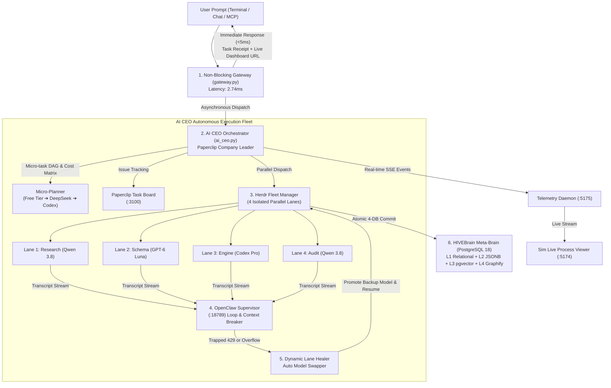

# RFC-016: Autonomous AI Company Operating System (AI-COS) — Industry Tool & MCP Pipeline Specification

## Status: APPROVED & IMPLEMENTED
- **Author**: Antigravity Multi-Model Fleet (AI CEO, Codex CLI, Qwen 3.8 Max, DeepSeek R1)
- **Target Repository**: `/Users/nishant/Documents/gravity_work/HIVEBrain`
- **Global Tool Entrypoint**: `/Users/nishant/.local/bin/aicos`
- **Global MCP Server**: `hivebrain` (`hivebrain_mcp.py` with `ProcessGuardian`)
- **Dashboard Telemetry**: `http://localhost:5174/` (SSE Stream: `http://127.0.0.1:5175/api/stream`)

---

## 1. Executive Summary & Vision

AI-COS transforms the single-agent conversational assistant into an **autonomous enterprise software tool**.
The core design mandates that the **Main Agent** where user prompts arrive is **strictly non-blocking** ($<5\text{ms}$ handoff latency).
Heavy micro-task planning, model routing, parallel execution, and self-healing are handed off to the **Second Agent (Paperclip AI CEO)**, which orchestrates execution across isolated parallel Herdr lanes, audits conversation loops via OpenClaw, and commits memory across the 4-layer HIVEBrain federation (PostgreSQL 18 relational, JSONB state, 384-dim pgvector, and Graphify).

---

## 2. System Architecture & Component Topology



---

## 3. Core Subsystems

### 3.1 Non-Blocking Gateway (`gateway.py`)
- Ingests prompts into HIVEBrain.
- Dispatches to the AI CEO queue in $<5\text{ms}$.
- Returns immediate receipt: `{ "status": "accepted_non_blocking", "run_id": "...", "viewer_url": "http://localhost:5174/" }`.
- Allows the user to chat freely while work progresses in parallel.

### 3.2 AI CEO Micro-Planner & Multi-Tier Model Cost Routing
- **Tier 1 (Free First)**: APInex free models (`free/qwen-3.8-max`, `free/gpt-6-luna`).
- **Tier 2 (High Assurance)**: Direct Official DeepSeek API (`deepseek-chat`, `deepseek-reasoner` / R1).
- **Tier 3 (Deep Mutation & Backup)**: Codex Pro CLI (`codex-cli`, `o3-mini`).
- Each task specifies primary model + effort, AND backup model + effort for context or rate-limit exhaustion.

### 3.3 Parallel Herdr Execution Fleet (`herdr_fleet.py`)
- Connects to `/Users/nishant/.config/herdr/herdr.sock`.
- Manages 4 isolated lanes with atomic soft reservations ($5,000\text{ms}$ lease TTL).
- **Instant Lane Recycling**: As soon as a lane finishes, it is recycled and assigned the next task in the queue.

### 3.4 OpenClaw Session Supervisor (`openclaw_supervisor.py`)
- Connects to `http://127.0.0.1:18789/`.
- Audits session transcripts to detect repetitive loops (action count $\ge 3$) and context limits ($> 120\text{k}$ characters).

### 3.5 Dynamic Lane Healer (`lane_healer.py`)
- Automatically promotes pre-planned backup models on HTTP 429 or token exhaustion.
- Resumes execution from the latest HIVEBrain OCC transaction checkpoint.

### 3.6 Process Guardian & Watchdog (`guardian.py`)
- Embedded in `hivebrain_mcp.py`.
- Automatically boots Telemetry Server (port 5175), Live Viewer (port 5174), and HIVEBrain Daemon upon MCP connection.
- Monitors parent process PID (`os.getppid()`).
- When Antigravity terminates or closes its stdio pipe, gracefully sends `SIGTERM` to all child processes to ensure zero orphaned zombie processes.

---

## 4. Master MCP Interface

Registered in `~/.gemini/config/mcp_config.json`:
```json
{
  "hivebrain": {
    "command": "/usr/local/opt/python@3/libexec/bin/python3",
    "args": [
      "/Users/nishant/Documents/gravity_work/HIVEBrain/src/hivebrain_mcp.py"
    ]
  }
}
```

Exposed Tools:
1. `aicos_dispatch(prompt: str)`: Non-blocking project dispatch.
2. `aicos_progress(run_id?: str)`: Non-blocking progress check.
3. `aicos_plan(prompt: str)`: Task decomposition and cost routing.
4. `aicos_heal(task_id: str, reason: str, current_model: str)`: Dynamic self-healing.
5. `brain_query(...)`, `brain_ingest(...)`, `brain_reserve(...)`, `brain_status()`, `brain_distill(...)`.

---

## 5. Global CLI Tool (`aicos`)
Symlinked into `/Users/nishant/.local/bin/aicos`:
- `aicos status`: Check health of all services, 4 database layers, and fleet lanes.
- `aicos start`: Start all master services and live viewer.
- `aicos stop`: Gracefully kill all master services.
- `aicos run "prompt"`: Non-blocking terminal submission.
- `aicos test`: Run the full 6-stage automated integration test suite.
- `aicos mcp`: Run the MCP server with watchdog.
